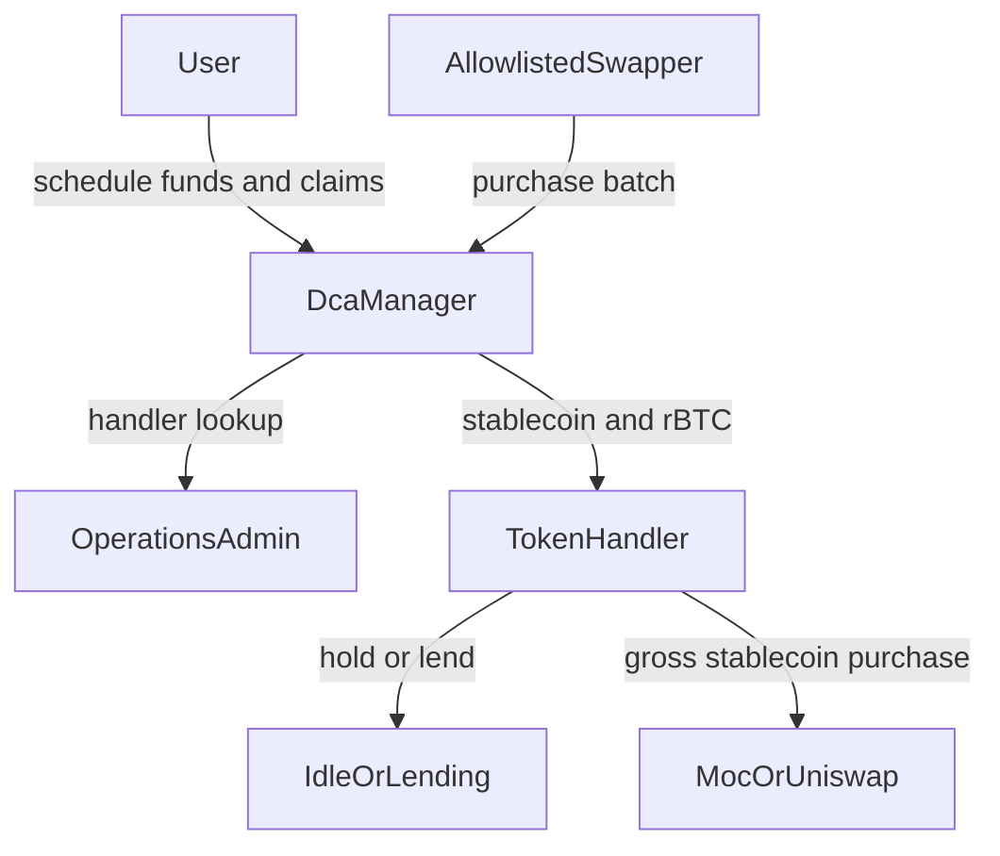

# Architecture

BitChill uses one manager, one registry, and one handler for each stablecoin and route. The contracts are not deployed.

This page describes every contract in the protocol source. The initial launch assigns two of the handlers: DOC idle and DOC LayerBank. See [Initial launch](/docs/getting-started/supported-assets#initial-launch-doc-only).

## DcaManager

The manager is the user entry and the swapper entry. It stores the schedule ledger. It does not hold the stablecoin, and it does not hold the rBTC.

A schedule is stored under the stablecoin and a decimal schedule id. The value holds the principal, the cadence anchor, the pause flag, the period, the route, the owner, and the purchase amount.

## OperationsAdmin

The registry maps a stablecoin and a route index to one handler. Index 0 is idle. The owner registers other indexes as idle or lending. The protocol uses index 1 for the LayerBank lending route. The contract constants name index 2 for Sovryn. The initial launch registers index 1 and does not register index 2.

The owner assigns a handler once for each pair. `assignHandler(token, routeIndex, handler)` reverts unless every check below passes:

- The handler is a contract, not an externally owned account.
- The route index is registered.
- The pair has no handler yet. An assignment is add-only.
- The handler address backs no other pair.
- The handler reports the token-handler interface through ERC-165.
- A lending route takes only a lending handler, and an idle route takes only a non-lending handler.
- The handler's stablecoin is the token of the pair.
- The handler's manager points back to this registry.

The owner can pause new deposits for one assigned pair. The owner keeps the swapper allowlist.

A pair with no handler is not active. A create on it reverts. `getHandler(token, routeIndex)` returns the zero address for it. The deployment decides the active pairs, not the code: a later pair on the same registry needs a handler and an assignment, not a new manager.

## Handlers

A handler custodies the stablecoin for one pair and the rBTC bought for that pair. Users call the manager. The handler accepts balance changes, purchases, and rBTC payouts only from its immutable manager. The handler's own owner sets its fee curve and, on a DEX handler, its oracle floor and path allowlist.

Each handler contract combines one holding base with one purchase venue:

| Holding base | What happens to waiting stablecoin |
| --- | --- |
| Idle | The handler holds the stablecoin. Each schedule balance in the manager is the liability. The handler balance is the pooled cover. |
| LayerBank lending | The handler supplies the stablecoin to the LayerBank pool. A per-user share book stores scaled receipt-token amounts. |
| Sovryn lending | The handler mints Sovryn iTokens. The same per-user share book stores the iToken amounts. |

| Purchase venue | How a purchase buys rBTC |
| --- | --- |
| Money on Chain | The handler redeems DOC at Money on Chain and measures the native rBTC it received. |
| Uniswap V3 | The handler swaps on its active path to WRBTC and measures the WRBTC it received. It unwraps WRBTC when it pays a claim. |

The protocol source has these handler contracts:

| Contract | Stablecoin | Route | Holding base | Purchase venue | Initial launch |
| --- | --- | --- | --- | --- | --- |
| `IdleDocHandlerMoc` | DOC | 0 | Idle | Money on Chain | Assigned |
| `LayerBankDocHandlerMoc` | DOC | 1 | LayerBank lending | Money on Chain | Assigned |
| `IdleHandlerDex` | USDRIF, USDT0 (one deployment each) | 0 | Idle | Uniswap V3 | Not assigned |
| `LayerBankHandlerDex` | USDRIF, USDT0 (one deployment each) | 1 | LayerBank lending | Uniswap V3 | Not assigned |
| `SovrynDocHandlerMoc` | DOC | 2 | Sovryn lending | Money on Chain | Not assigned. Route 2 is not registered. |
| `SovrynHandlerDex` | A stablecoin that Sovryn lends | 2 | Sovryn lending | Uniswap V3 | Not assigned. Route 2 is not registered. |

The DEX handlers are implemented and tested. The initial launch does not assign them. See [Enabling USDRIF and USDT0](/docs/getting-started/supported-assets#enabling-usdrif-and-usdt0). Tropykus is not a handler route in this protocol. An idle handler does not lend. See [Not at launch](/docs/getting-started/supported-assets#not-at-launch).

### Shared building blocks

| Block | Role |
| --- | --- |
| `TokenHandler` | Deposit and withdrawal of the stablecoin, manager-only. ERC-165 interface. |
| `IdleHandler` | Holding base with no lending and no per-user book. |
| `LendingHandler` | Per-user shares, share-to-stablecoin conversion, withdrawal clamp, interest, and the exact-sum batch redeem. A LayerBank or Sovryn adapter adds the venue calls. |
| `PurchaseRbtc` | The purchase pipeline: retrieve the stablecoin, scale the caller minimum, buy, check that the input was fully spent, split the output, and pay claims. |
| `PurchaseFees` | The fee curve and the fee collector. |
| `PurchaseMoc` | The Money on Chain venue. |
| `PurchaseUniswap` | The Uniswap V3 venue, with the oracle floor and the path allowlist. |

## Who can call

| Caller | Allowed work |
| --- | --- |
| Schedule owner | Create, fund, edit, pause purchases, withdraw, delete, and claim for that account |
| Allowlisted swapper | Submit a purchase batch and open the protected purchase window |
| Owner | Set routes, handlers, deposit pauses, swappers, fee parameters, token minimums, and schedule limits |

## Purchase path

The swapper submits one or more due schedule ids for one stablecoin and one route. The manager reads the buyer and the gross amount from the schedule. The handler spends that gross stablecoin. The fee is a share of the measured rBTC output. The buyer is credited with buyer-net rBTC.

A batch carries a gross minimum output and the stablecoin input that the minimum was quoted for. The handler scales the minimum to the actual input and rounds up. If the measured gross output is below the scaled minimum, the purchase reverts. See [Purchase minimum](/docs/contracts/core-contracts#purchase-minimum).

The handler also checks that the venue took exactly the retrieved stablecoin. A partial spend reverts the batch with `PurchaseRbtc__InputAmountNotFullySpent`. A DEX handler also requires the router's balance of each intermediate token to end where it started.

## Read next

- [Core calls](/docs/contracts/core-contracts)
- [Address status](/docs/contracts/addresses)
- [Integration notes](/docs/contracts/integration)
