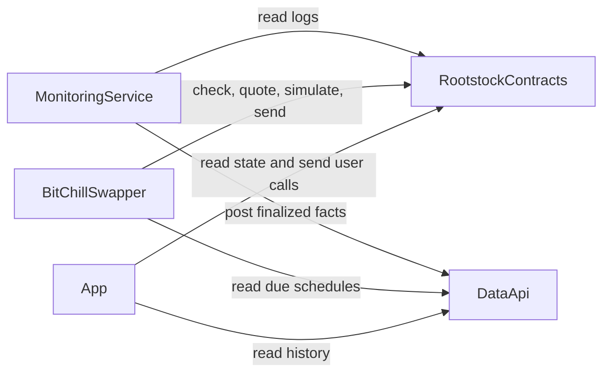

# Offchain services

The contracts hold the funds and enforce the rules. Four offchain services work around them: the BitChill swapper, the monitoring service, the data API, and the app. These services are operated software, not contracts. Their addresses and settings come from deployment configuration. The protocol is not deployed, so these pages publish no service address and no operator value.

No service is needed for a user exit. A user can withdraw, delete, and claim with a direct contract call. A missing or stale offchain copy never blocks that call.

## How the services connect

## Active pairs come from the deployment

Each service knows the catalog: DOC, USDRIF, and USDT0, each on idle (index 0), LayerBank (index 1), and Sovryn (index 2). The active pairs come from the deployment, not from a fixed list in code:

| Service | Source of the active pairs |
| --- | --- |
| Swapper | `getHandler(token, routeIndex)` on the registry, for each configured stablecoin |
| Monitoring service | The handler addresses in its configuration |
| Data API | The deployment manifest |
| App | The deployment manifest, checked on chain before a create or a deposit |

Any non-empty subset of the catalog pairs is valid. The initial launch configures two pairs: DOC idle and DOC LayerBank. A catalog pair that a later reviewed configuration assigns on the same contracts needs configuration only, not code. A venue outside the catalog needs code for its name and its lending rule.

## Swapper

The BitChill swapper is an allowlisted account that submits purchase batches. This section describes its behaviour at a high level. Its operator values are not published here.

### What it buys

- It reads due schedules from the data API and checks them against the chain before a send.
- For each configured stablecoin, it buys on every catalog route where the registry has a handler. A zero handler is skipped. A failed read omits that group and is reported. A later handler assignment needs configuration only.
- At the initial launch, it is configured for DOC only. A DOC-only configuration needs no DEX path, no quoter, no WRBTC address, no execution-quality tolerance, and no price-impact limit.
- It buys each schedule at most once in one run.

### Quoted pairs

- Each handler group keeps `quotedStablecoinIn` and `minRbtcOut` together as one pair through the simulation, the send, and a retry.
- A stale DOC quote is quoted again once, and the new pair replaces the whole old pair. A stale Uniswap quote is not quoted again. That group is omitted.

### DOC through Money on Chain

- A DOC group always has a positive minimum. The swapper computes the expected native rBTC from Money on Chain redemption pricing, after Money on Chain fees and before the BitChill fee. It then subtracts a configured tolerance.
- If that quote fails, the swapper omits the DOC group. It never sends a DOC group with a zero minimum. Other groups can still go.
- Before a send that contains DOC work, the swapper reads the Money on Chain gas price cap and the free DOC capacity. A DOC group that does not fit waits for a later run. Every DOC route uses the same quote and the same checks.

### USDRIF and USDT0 through Uniswap V3

These rules apply when a reviewed configuration enables a DEX token. The initial launch does not enable USDRIF or USDT0.

- It accepts only one configured swap path for each DEX token: USDRIF → USDT0 (0.05% pool) → WRBTC (0.30% pool), and USDT0 → WRBTC (0.30% pool). Before a quote, it reads the handler's active path on chain. A different path omits that handler's group.
- It quotes the DEX groups of one transaction together, in transaction order, because a later group trades after the earlier groups on a shared pool.
- Execution quality: it omits a group whose quote is too far below the reference that the handler's own oracle gives.
- Price impact: it omits a group whose quote is too far below the pool price before the transaction.
- These two limits are required settings for a DEX token. They have no default. The swapper does not start when a DEX token is configured and either limit is missing. Their values are open operator decisions.

### Size limits

Row and batch size limits are optional. With no limit set, no row cap and no batch cap applies. With a limit set, the swapper defers a row or a batch above it. The swapper never splits a handler group into several transactions.

### Failure handling

- On a lending route, a row whose user has no share value left is excluded after a decoded simulation revert. The rest of the transaction is simulated again.
- A route that fails for another reason fails only its own group in an isolated retry. Unrelated healthy groups are still sent.
- It simulates the exact transaction before the send. A simulation shows only success or failure. It is not a measured price.
- When that report is configured, it reports a share-consumption mismatch revert to the monitoring service, which sends an alert.
- It does not open the protected purchase window.

A group or a row that the swapper omits stays due. If it waits past its next due day, a later purchase consumes only the newest due slot. There is no catch-up.

## Monitoring service

The monitoring service turns contract logs into facts for the data API.

- It reads the logs of the manager, the registry, and the configured handlers by address. It reads only ranges that are a configured number of blocks behind the chain tip.
- It posts each range once, in chain order. Its cursor moves only after the data API accepts the post. A failed post is sent again on the next poll.
- It follows the [event order](/docs/contracts/integration#event-order) of the contracts. A deposit or a withdrawal logs the balance before the handler call.
- A handler assignment, a schedule, or a deposit pause outside the configured pairs stops the range. The service never guesses a handler.
- The data API stores one block-hash checkpoint for each posted range. The service compares the stored checkpoints with the chain at each start, after each rollback, and on each poll. A checkpoint that is no longer on the chain proves facts from an old branch, and the service rolls the data API back to a verified checkpoint. A reorg deeper than its bound stops ingestion. When no common block is known, it sends an alert and does not roll back.
- After several failed polls in a row, it sends one stall alert with a stable error code. It sends a recovered notice when a poll succeeds again.
- It names a handler revert from the handler ABI and gives it a class, for example an invalid swapper payload, a result below the swapper minimum, a venue anomaly, or a lending error.
- It alerts when the LayerBank pool or a LayerBank receipt-token proxy changes its implementation.

## Data API

The data API stores the facts that the monitoring service posts. It does not read the chain. The contracts stay the source of truth.

- It serves one deployment from a deployment manifest. The manifest gives the deployment id, the chain id, the manager, the registry, and each active stablecoin and route with its handler. The initial launch manifest lists DOC idle and DOC LayerBank.
- A seed step registers the manifest rows once. A later pair is appended to the same deployment. A changed or removed registered row is refused.
- Each fact must come from the right contract: a schedule fact from the manager, a deposit-pause fact from the registry, and a purchase, fee, yield, or cash fact from a handler in the manifest.
- Read routes are under `/api/v2/deployments/:deploymentId/`. They cover the deployment and pair metadata with the deposit-pause flag, schedules and due schedules, purchases, purchase batches, fee credits, interest and cash flows, and reporting totals.
- The monitoring routes for facts, rollbacks, the cursor, and the block-hash checkpoints need a service token.
- No public host is published. The app and the metrics dashboard reach selected read routes through their own server proxies.

## App

- It offers the pairs that its deployment manifest lists. A stablecoin with no listed pair is not offered for a new schedule. At the initial launch, it offers DOC on idle and on LayerBank.
- Before a create or a deposit, it reads the pair's handler and deposit pause on the registry. A missing handler, a paused pair, or a failed read disables the create and the deposit.
- It accepts a schedule only against the token minimum (`getTokenMinPurchaseAmount`) and the minimum period (`getMinPurchasePeriod`) that it reads on chain. The manifest minimum is display data only.
- For a LayerBank route, it shows an indicative supply APY from the LayerBank pool's current variable rate. The figure assumes that rate for one year with per-second compounding. It excludes incentive rewards. It is not guaranteed and it is not a BitChill rate. When the read fails, the app shows that the APY is not available.
- For interest actions, it reads `getAccruedInterest` on chain.
- It shows the gross stablecoin cost and the buyer-net rBTC. It does not show a per-purchase fee row.
- Existing schedules and exits stay visible for every pair that the manifest lists.

## Read next

- [Core calls](/docs/contracts/core-contracts)
- [Integration notes](/docs/contracts/integration)
- [Supported tokens and routes](/docs/getting-started/supported-assets)
